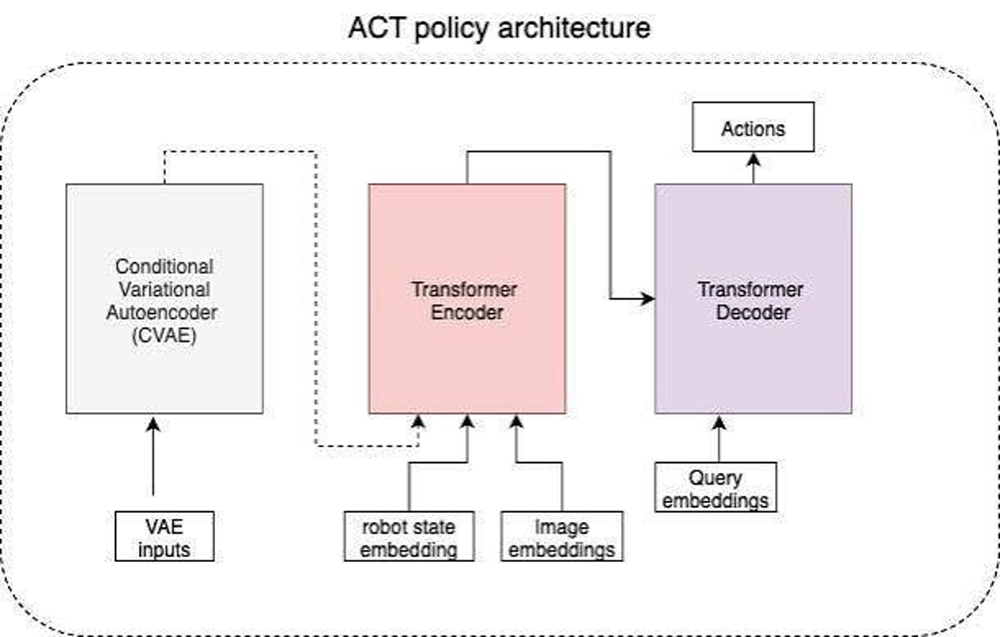
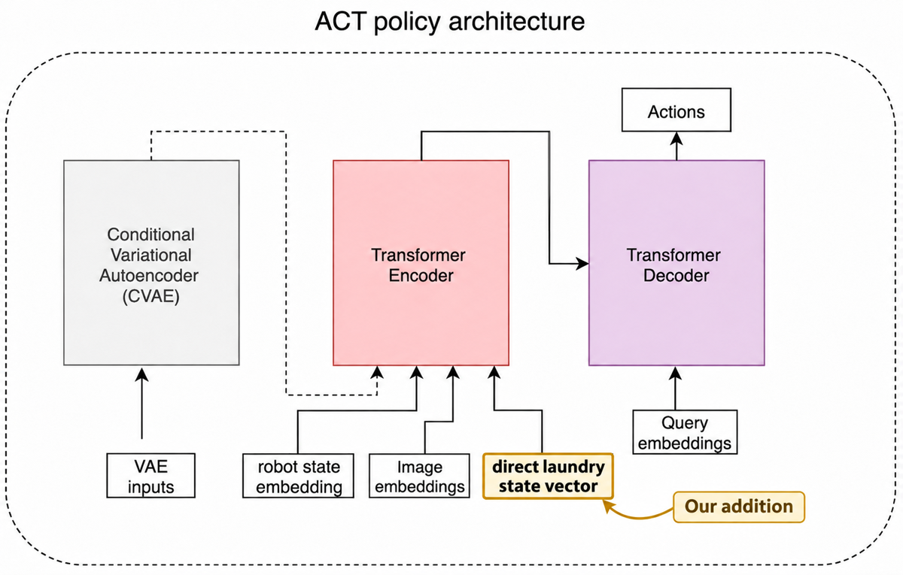

# Using Machine Vision to Optimize Action Chunking Transformers for Laundry Folding in Simulation

By: Premkumar Sethumadhavan

  
  

________________

## Goals

This project was an exploration of using machine vision to optimize Action Chunking Transformers (ACT), specifically in the context of dexterous manipulation in simulation. 

Before explaining the project technically, I want to take the time to explain the background behind what prompted this investigation and what was actually performed at a high level. Several months ago, I participated in a competition for robotics and machine learning called the LeHome Challenge. The challenge consisted of training deep learning robotics policies for bimanual laundry folding using SO-101 robot arms (open-source 5-degree-of-freedom robot arms). The competition provided a repo that builds on Isaac Sim and Isaac Lab, NVIDIA’s open-source physics simulator and engine for robotics. As a result, all the infrastructure needed for deploying a policy to fold laundry was abstracted away from participants; all that you needed to do was train the policy, and they provided initial data for training as well. For my final submission, I ended up doing a bunch of data manipulation to try and optimize ACT policies and, in the end, placed 28th, far from the top 8 finish I was aiming for. I learned the hard way that data manipulation alone was not enough and that architectural policy changes were necessary for meaningful results. With the announcement of this project, I knew immediately that I wanted to investigate whether using machine vision to modify the policy architecture of ACT policies could meaningfully improve laundry folding capabilities, and I decided to investigate it using the same open-source repo. Thus, the goal of this project was to investigate whether altering the architecture of an ACT policy to implement machine vision in some form could improve its accuracy in laundry folding. As a closing note, I want to emphasize that all my work revolved around creating this policy; I do not, in any way, shape, or form, take credit for the work done by the LeHome team and Lightwheel to create the open-source repo and simulation environments where I performed my testing. 

## Problem Solving Approach

In order to solve the problem, I used a machine-learning-based approach where I fine-tuned a pretrained convolutional neural network (CNN) to classify laundry states before feeding them back into the ACT. In order to explain this approach, I am going to explain what this means at a high level and then what was actually implemented on a more granular level. 

First, my goal for this project was to feed a machine-vision-produced input into the ACT policy architecture. But I think it is important to first explain what the ACT policy architecture is. 

Figure 1

For the sake of keeping this explanation straightforward and quick, I am going to skip over some of the finer details of how an ACT policy works under the hood, but if you are interested in understanding the architecture on a deeper level, I recommend you read the original paper: https://arxiv.org/abs/2304.13705. The ACT policy takes in embeddings and predicts what the robot should do from these embeddings. The two embeddings are one for robot state, which in our case is 12 joint angles for our robot arms, and one for the images the robot sees, which in our case come from a camera on the wrist of each robot arm and a top-down camera focused on the laundry. It feeds these embeddings, which are vectors, or essentially long sequences of numbers, into a transformer. A transformer is a fundamental component of machine learning models that essentially finds correlations between what you feed into it. Therefore, when we feed it vectors for the robot state and images, it finds correlations between these two things and predicts what the robot should do. But the transformer doesn’t understand what to tell the robot to do out of the box. In order to make it predict meaningful actions, we feed it a third input during training from the CVAE. For our purposes, we can just consider the input from the CVAE to be the future joint states the robot arm goes to after its current joint and image states. Therefore, the transformer is able to find patterns between these three things, but when actually running the model, we do not feed it inputs from the CVAE; we only provide its robot joint state and image state, and it predicts future states from there. What we are now aiming to do is feed a fourth input into the transformer, another vector created through machine vision that the transformer will learn correlations for. 

Figure 2

The diagram above should help more clearly explain the machine vision being performed for this project. What we did to try and optimize the ACT policy was feed in another embedding, the same way we fed in embeddings for image state and joint state, specifically for laundry state. I think it’s important to clarify that it can be argued that some of this information may be repetitive because the image state is already fed into the model. But my counterargument to this point is that ACT policies are extremely brittle, meaning they struggle in new environments or states not previously seen, so I believe that if we can provide any extra meaningful correlation between predicted trajectories and the current state, we can improve the policy. 

I now want to explain what this laundry state vector is and how we got it on a more specific level. In order to assist with laundry folding, I brainstormed a bunch of visual indicators that could help throughout the laundry folding process. My first thought was to feed in a vector of laundry folding scores showing how well the model was folding the laundry, but this felt too subjective to train an image classifier to understand. My next idea was to feed in a vector indicating whether the last fold was successful, but I felt that this would only provide a reactive signal to inform the policy that it had erred and not actually teach it anything meaningful during training, as the training demonstrations do not have errors within them. Then I reached my final idea, which I implemented: creating a classifier for four states—performing the left laundry fold, the right laundry fold, the bottom fold, or being finished folding. I believe that these states are extremely valuable indicators, as they provide the policy with a better signal of what trajectories are supposed to come next for any given state. In terms of actual code, the literal representation is an array, as shown below: 

Array Example:  [val1, val2, val3, val4]

Each value, from val1-4, represents the probability that the model believes it’s in one of the following ordered states: left fold, right fold, bottom fold, or done. The way I obtain this vector for the data we train on is by taking a ResNet, or residual network—an open-source pretrained convolutional neural network (a neural network trained to understand images)—and fine-tuning it on a dataset of laundry pictures I manually collected. To get this data, I ran a base ACT policy I trained on a provided eval dataset from LeHome and manually took screenshots of states I believed would be meaningful signals for our ResNet network to train on. Then I trained the ResNet network to predict a label of left fold, right fold, bottom fold, or done based on a labeled dataset of these laundry images. 

After training the network to do this, I ran it over all the images in our training dataset and appended this new vector with 4 values to a new column I created in the dataset called “environment_state”. The reason I named the column this is because the base ACT implementation already has an input branch named environment state that is unused by the LeHome repo. Currently, it receives no input and doesn’t even have a data size defined for it, so I decided to take advantage of this and repurpose the environment state branch of the ACT policy as our laundry state branch by appending our new laundry state vector to this part of the dataset. After this, the training workflow for ACT is exactly the same: run it over the dataset and let the transformer find the best correlations to accurately predict future joint states. However, deploying the policy requires a few extra steps. In order to make this possible, we have to run our trained ResNet model live and append its laundry vector to the image and joint state vectors provided by the LeHome evaluation data, the same way we did for the training dataset. This concludes my explanation of how I actually implemented machine vision into the ACT pipeline. 

## Design Decisions

A major design decision I made that I want to highlight was the choice of using a pretrained convolutional neural network instead of training one from scratch.

In short, the reason I made the decision to use a pretrained CNN was that, after attempting to train one from scratch, I got very poor generalization for anything outside of my training dataset. But I came up with points both for and against using a pretrained CNN. 

I initially heavily considered using a custom-trained CNN for several reasons. The largest reason was that I assumed using a pretrained model would be too large and slow for real-time inference. Running inference for an ACT policy is already quite computationally intensive, and I thought adding another pretrained encoder would make this far too slow. I was incorrect in this assumption, however. Additionally, I believed that the extra knowledge that came with pretraining would not be relevant to the specific goal of classifying laundry states. Our environment is hyper-specific: it is a simulation of laundry folding with LeRobot SO-101 arms, and I don’t think there is any dataset an open-source pretrained CNN could have trained on to help us with this specific use case, meaning its extra training knowledge would just be blubber. On the flip side, however, I acknowledged that if inference time (or the time it takes to run a model) was not a factor, I would want the largest model trained on the most data. I also acknowledged that a pretrained model may have been trained on real-life laundry states, and the simulation environment may mirror this closely enough for that pretraining to be useful for our purposes. These reasons then led me to make my first attempt using a CNN that I trained from scratch. However, I quickly found that my model would tightly overfit to the training dataset and not generalize far beyond it. Looking back, it’s pretty obvious to me that this was because it lacked a larger pretraining phase to fall back on for things outside the scope of its training set. As a result of this immediate failure, I switched to fine-tuning a ResNet CNN, immediately saw better results, and stuck to using it for the remainder of the project. 

## Challenges

There were two major challenges I faced when working on this project. The first was dealing with the installation time and dependency errors with Isaac Sim and LeHome. The second was dealing with GPU allocations on the Unity Cluster. 

Downloading Isaac Sim and getting it to work in conjunction with LeHome was much more difficult than I remembered. Downloading everything I needed just to get the repo working took around 3 hours. Then, during my initial test of booting up the simulation, I was thrown several dependency errors I recognized, which I was able to resolve quickly by downgrading a few packages. But after fixing these, I was thrown an error during a later phase of the Isaac Sim boot sequence: “AttributeError: module 'warp.types' has no attribute 'array'”. I could not understand at all what Warp was or why I was being thrown this error, and I spent around an hour trying to figure out what Warp was and why I was missing this attribute until a forum clearly explained that this was just another dependency error caused by the latest Isaac Sim update. So, after around 4 hours of setup, I was finally able to get the repo working as intended and started the training run for the base ACT policy I needed for data collection. 

Dealing with allocations on the Unity Cluster (a green high-performance computing cluster Olin has a partnership with) was also a challenge. Previously, when I worked on the LeHome Challenge, it was very simple to get high-VRAM GPU allocations on Unity. However, I suspect that, due to overuse of these high-compute nodes, they’ve recently moved all of the higher-end GPUs onto their own separate node away from the normal GPU allocations. Thus, all of the traffic has slammed onto one node, and wait times for the GPUs I needed for this project (NVIDIA L40s, A40s, and A100s) got much longer. Additionally, after I would get a GPU node and start a training run, on my first few attempts, around 1.5 hours in, I would get thrown a pin-memory error, the training run would end, and the GPU would idle for the remaining time I had allocated. When this happens, Unity takes note of your lack of GPU utilization during allocations and sends you an email recording this, informing you that misuse of a high-performance node is being monitored and dealt with accordingly. So, all in all, it was much more difficult to use the Unity Cluster this time around because of the new safety provisions, but I am extremely grateful nonetheless to have access to such an amazing resource for training models with such powerful compute. I do not at all want to come across as ungrateful; I am very thankful that Olin has provided us with this resource, and even though it was slightly more difficult to use this time than the last, it was extremely effective for what I needed it for. 

## Project Improvements

If I had more time, there are several things I would have liked to have done for this project, but I’d like to touch on the main two improvements I could see for this project. 

The first main improvement I would have liked to make to this project is to implement some sort of reinforcement learning. After recording failure rollouts where one sleeve failed and the other did not, I would have liked to try using RL to teach the model to still fold the failed sleeve instead of stalling out. I believe one way I could have used RL combined with our laundry state vector is by having an output head on the model where the model predicts what the next best laundry state is and then comparing that to what the ResNet model believes it is on the next iteration. I think this could be just one reward implemented, and there could be others if I spent more time trying to implement and test RL for this setup. 

The second improvement I would have liked to make to this project is to record more data. After fine-tuning the ResNet model and making sure it worked on a few random screenshots I took for the sake of testing, I didn’t really validate it much further. As a result, when using it for training, there could be plenty of extraneous values being thrown around that may actually be throwing off the learning process slightly. I think recording some more data that includes edge cases by hand could mitigate this.

## Lessons For the Future

I learned so many valuable things for the future, which I will list. The first really important thing I got out of this project was understanding how to modify existing policy architectures. I obviously do not understand this well enough to edit any existing policy I have access to, but I understand the gist of how the process works much better now and believe that I can test more cool experiment ideas I have down the line more confidently now. Furthermore, I also understand how to use GPUs on an HPC much better now. Previously, when working on LeHome, it felt like all I needed to do was request the most powerful GPU possible and use it as long as I could. Now, I think I understand much better how to divide up training runs and how to better scope what GPU I want to use for a given task. 

## Real-life Use Cases

I truly believe that within the next 2-3 years, autonomous robots will be ubiquitous in the world around us. These robots will most definitely be using some form of deep learning, with teleoperation intervention from a human potentially helping out with edge cases. They probably will not use ACT policies, but rather larger pretrained foundation models like VLAs and world models. This project, I think, is an example of the kind of thing robots will soon be doing for us autonomously in our day-to-day lives, but not necessarily how those things will be done.  

To continue, I actually believe that laundry folding and dexterous manipulation around the house will be some of the first things robots will do for us. Look at these companies working on humanoids for the home that have already made astonishing progress in laundry folding: 

Sunday Robotics: https://www.youtube.com/watch?v=d7I1wj0Gkik&t=4s 

Figure: https://www.youtube.com/watch?v=HOoRnv3lA0k
